# Satisfeito

**English** | [Português](README.md)

> Simple, fast customer satisfaction surveys for businesses.

This repository is the project's **showcase**: it shows what Satisfeito does, the screens and the technical decisions. The system's source code lives in a private repository.

**Live demo:** https://meusatisfeito.com.br (company sign-up is by invitation)

---

## What it is

Customers scan a **QR code** on the table, at the counter or on the receipt, answer in under 30 seconds on their phone, and never create an account. The business owner follows everything in a **dashboard** with averages, charts and an **AI-written report**, ready to copy and send to the team on WhatsApp.

Built by a Computer Science student, in real use at the first business (a snack bar) and designed to be offered to others.

## See it working

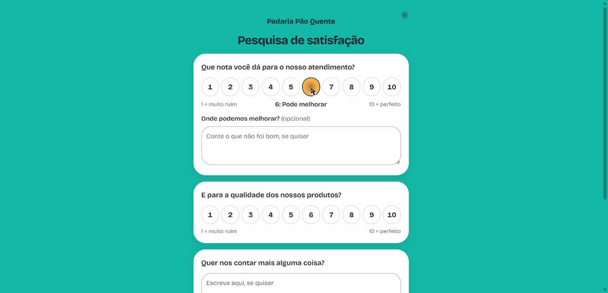

About 20 seconds, with sample data (a fictional bakery): the customer gives scores and writes a comment, the owner sees the results with the comparison to the previous period, filters the responses by a word and opens the poster with the QR code. The survey is filled in only up to the **Enviar** (Send) button, and no response was submitted. It was recorded on a computer; on a phone the survey fills the whole screen. The app itself is in Portuguese.

## Screens

**Survey answered on the phone** (opened by the QR code, no login). A 1 to 10 score and, when the score is not the maximum, an optional "Where can we improve?" box:

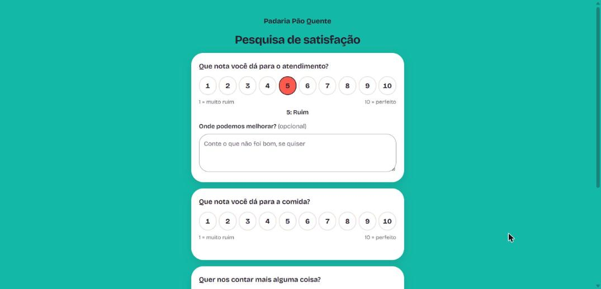

**The business picks the scale**: 1 to 10 or 1 to 5, per survey. On the 5 scale the box opens for a score of 4 or less (on the 10 scale, 9 or less). The choice locks after the first answer, so averages never mix scales:

| 1 to 5 survey | Picking it in the editor |
|---|---|
| 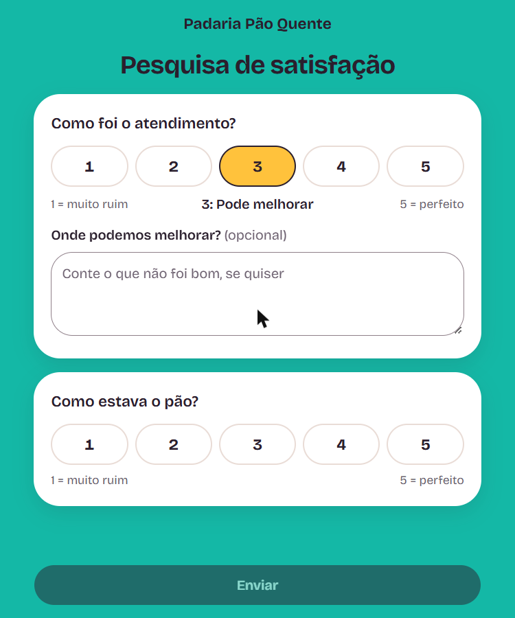 | 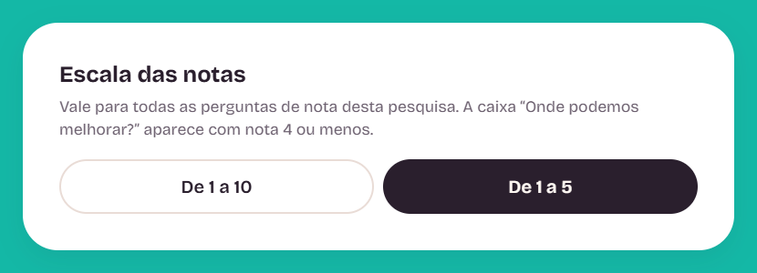 |

**Company dashboard**

| Home | Surveys |
|---|---|
| 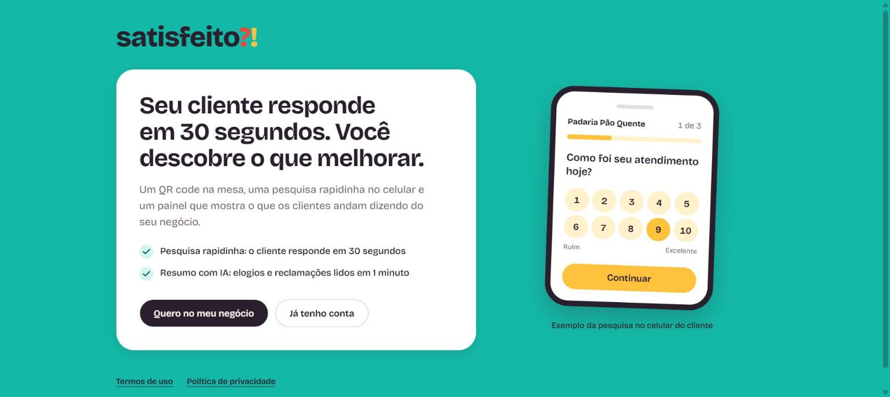 | 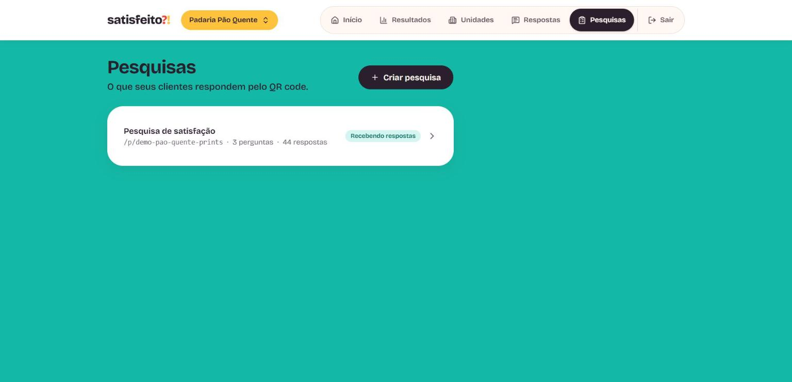 |

| Link and QR code | Question editor |
|---|---|
| 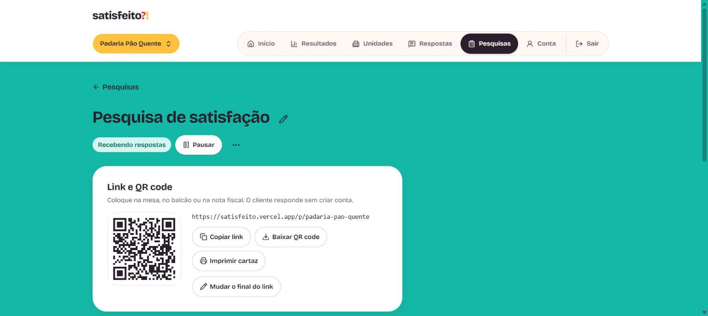 | 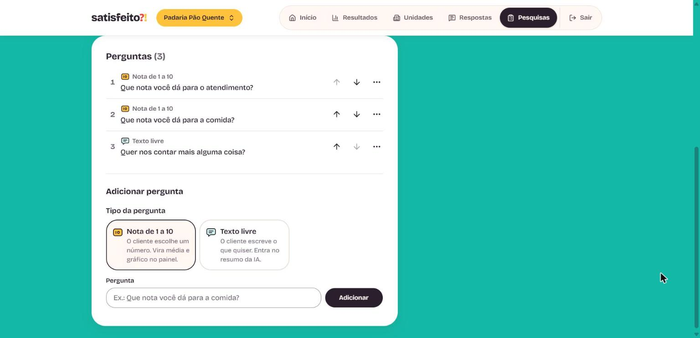 |

**Results**: 7, 30 or 90 day periods, comparison with the previous period, NPS, score distribution, weekday and shift:

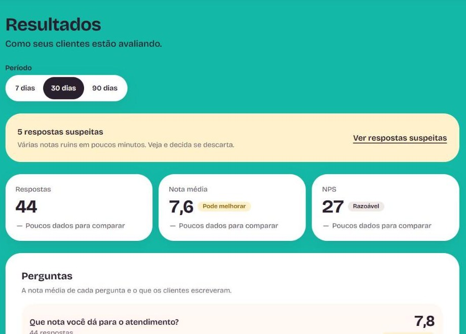

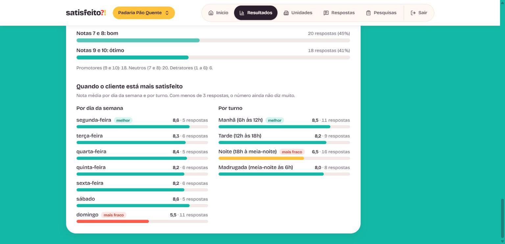

**Responses**, with a suspicious badge, a discard option and, on discarded ones, "Apagar de vez" (delete for good, with confirmation) to clean up test responses:

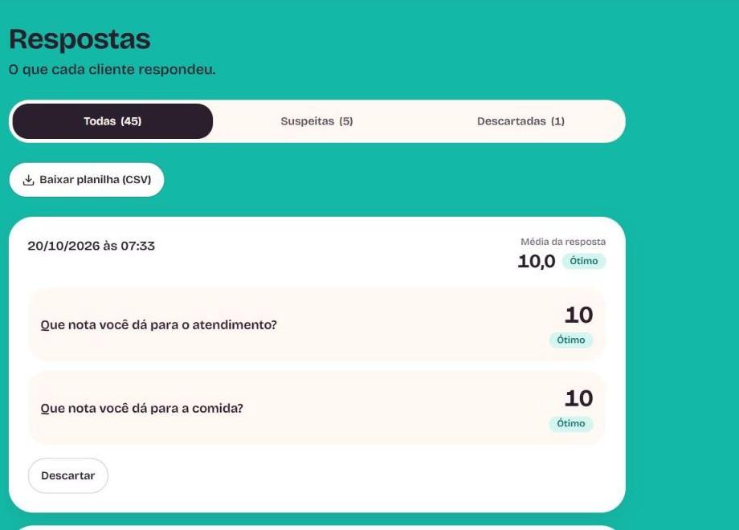

**Team report** (text ready for WhatsApp):

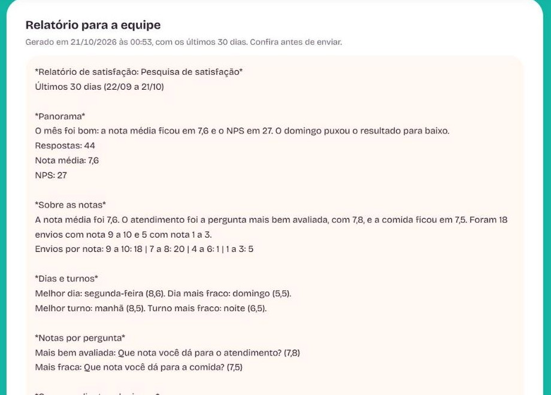

**Poster to print**, in light and dark versions, with the survey QR code and the business name:

| Light | Dark |
|---|---|
| 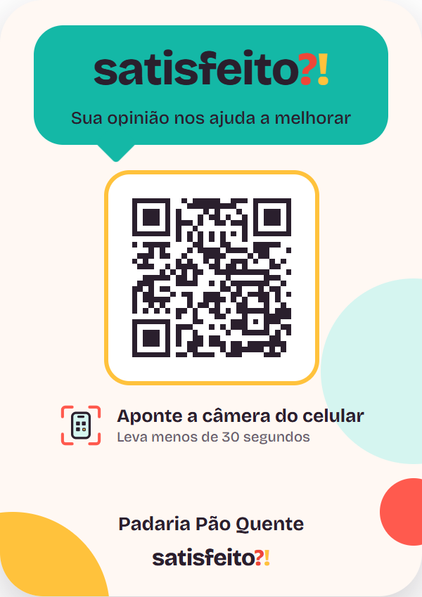 | 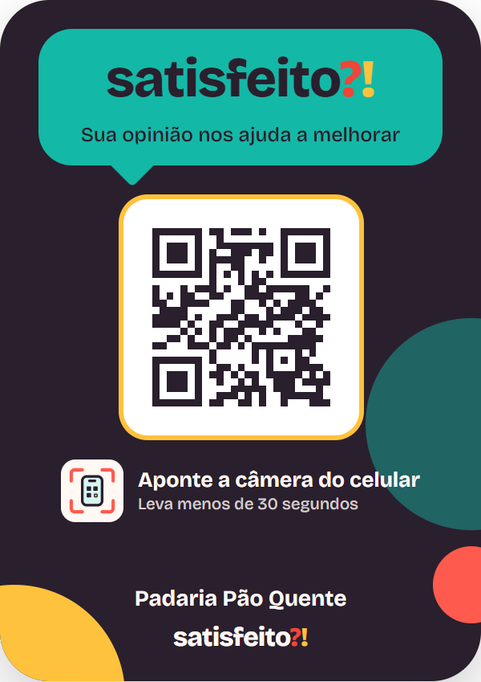 |

**Example dashboard on the home page**, drawn with the same components as the real dashboard (it is not a photo), so it stays sharp and follows the visitor's light or dark theme:

| Light | Dark |
|---|---|
| 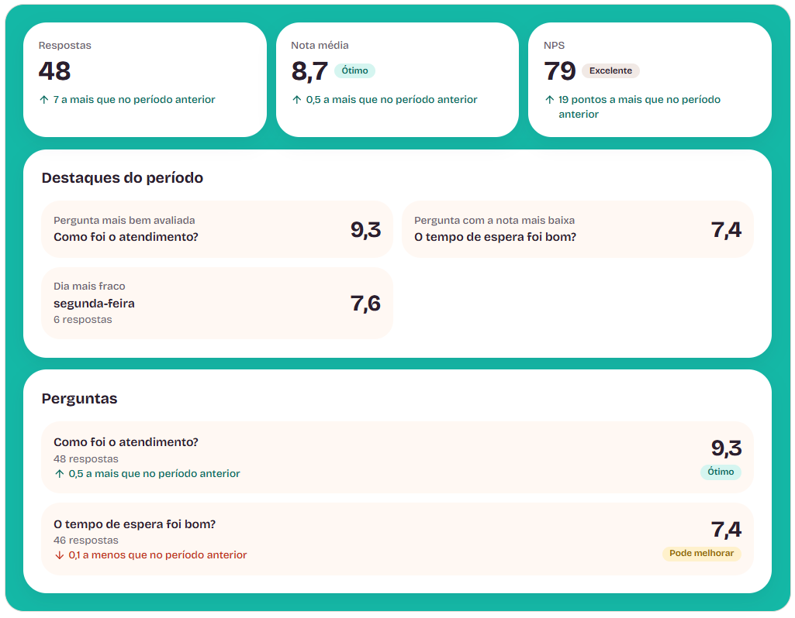 | 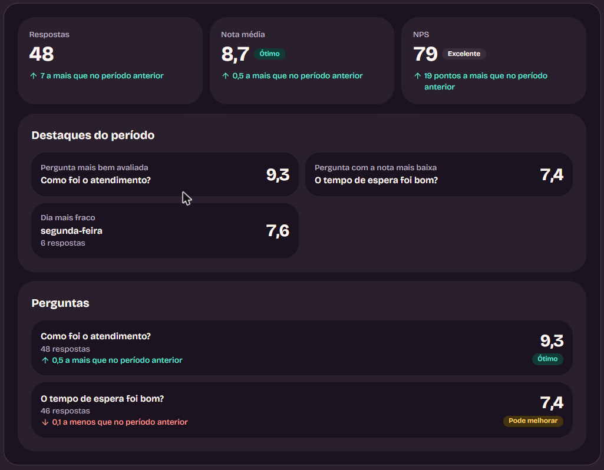 |

**Poster on the home page**, also built with the real component: visitors see the poster exactly as it prints.

| Light | Dark |
|---|---|
| 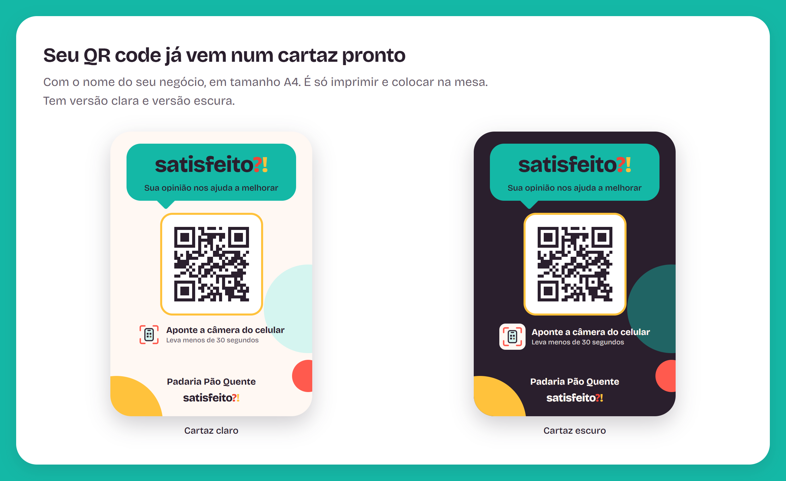 | 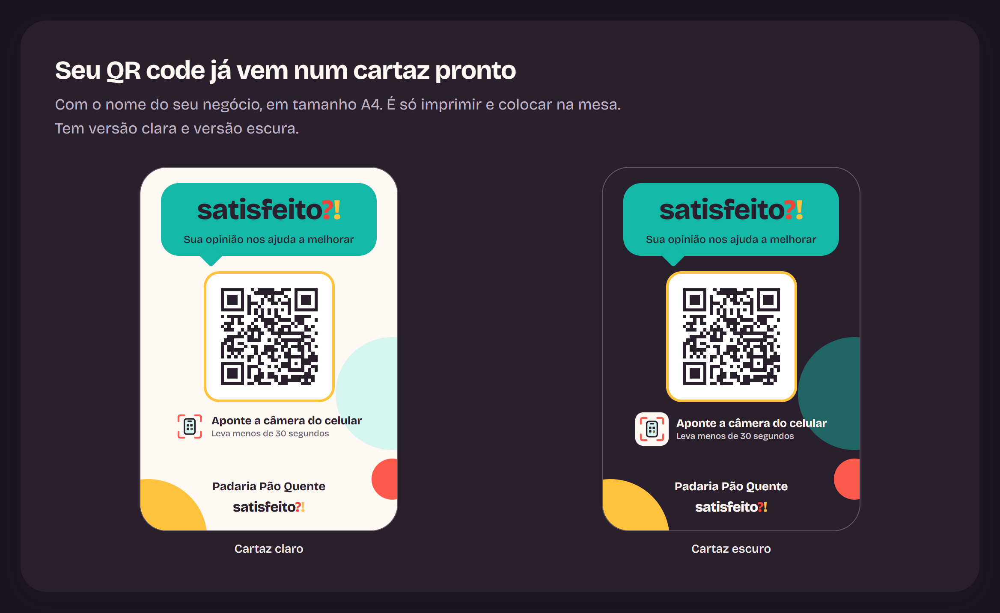 |

> The numbers in the screenshots are sample data created only for the demo, and the AI text in the report was simulated. The app itself is in Portuguese.

## Tech stack

| Layer | Technology |
|---|---|
| Framework | Next.js 16 (App Router) + React 19 |
| Language | TypeScript |
| Styling | Tailwind CSS 4 |
| Database and auth | Supabase (Postgres + Auth) with RLS |
| Charts | Recharts |
| Anti-bot | Cloudflare Turnstile |
| AI | Anthropic API (Claude), called from the server only |
| Hosting and CI | Vercel and GitHub Actions |

## Technical decisions I want to highlight

- **Data isolation in the database.** Each company reads and edits only its own data through Postgres RLS rules, and automated SQL tests in CI prove it, including the server-only tables.
- **Fake-response protection that does not punish real customers.** Browser mark, minimum answer time, Turnstile and a dashboard that flags bursts of bad scores as suspicious for the owner to discard. I decided **not to use IP**: the venue Wi-Fi is shared and would block real customers. Turnstile fails closed: without a valid token the response is not stored.
- **AI on a short leash.** Customer text is treated as data, never as instructions. The AI writes only the prose; the report numbers come from the database, and the server rejects the text if the AI invents a number. There is a usage cap per owner and the slot is reserved in the database before calling the API.
- **Single-use invitation sign-up.** The owner generates an expiring link; the database stores only the code hash and the server "spends" the invite with one conditional `UPDATE`, so the same link cannot create two accounts.
- **Accessibility and mobile-first.** 44 px touch targets, checked contrast, tested focus and screen reader, axe-core audit, Portuguese interface with no emojis (custom SVG icons).
- **Right to erasure (LGPD).** Owners delete their account, companies, surveys and every response from their own dashboard.
- **Installs as an app, no app store.** The dashboard is a PWA: manifest, custom icons and an "Add to home screen" button on Android. iPhone does not allow that button, so the dashboard shows the Safari step by step instead. No service worker on purpose: the dashboard depends on the database, so working offline would not help.
- **Several companies under one login.** A selector switches company, and when creating a survey you can **copy the questions** from another company of the same owner instead of typing everything again. RLS rules guarantee only the owner's own surveys show up.
- **Filters on the response list.** Search in comments, score range and period, in a plain form (GET method, no JavaScript) with the values in the URL, so the link can be saved. Validation runs on the server and the logic lives in a Postgres function with SQL tests: the period uses the day in São Paulo, and `%` and `_` typed in the search count as plain text. The suspicious flag is still computed over all responses, and the CSV export follows the same filters.
- **Score scale per survey.** The business picks 1 to 10 or 1 to 5. Scores are stored as the customer gave them, and the dashboard brings everything to the same ruler only where it must compare: color bands, burst detection and the filter use the proportional score (4 of 5 counts as 8 of 10). NPS only exists on the 10 scale. The database rejects out-of-scale scores and locks the change after the first answer, with SQL tests in CI.
- **Ready-made survey for the customer.** The system owner, who maintains the question catalog, picks a survey and sends a copy to the customer's account, which finds it ready. The write uses the server key, but only after checking that the caller is the admin, that the survey is theirs and that the destination company belongs to someone else. The signup invite can also carry a template survey: the new account is born with the copy, and if the copy fails the signup still goes through.
- **Deleting safely.** Responses can only be deleted for good after being discarded, with a confirmation dialog. The server checks through RLS that the response belongs to the user and is discarded, and only then deletes with the server key.

## Want to see the code?

The code is in a private repository. If you are a recruiter or want to talk about the project, reach me through my GitHub profile: [@CaioPortela17](https://github.com/CaioPortela17).

## Rights

© 2026 Caio Portela. All rights reserved. The texts and images in this repository may not be copied or reused without permission.
