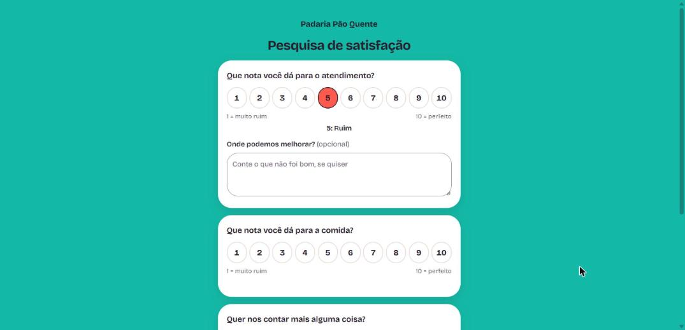
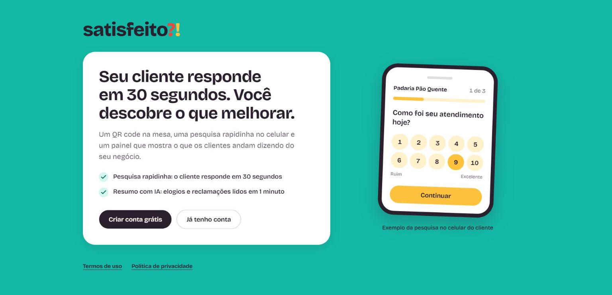
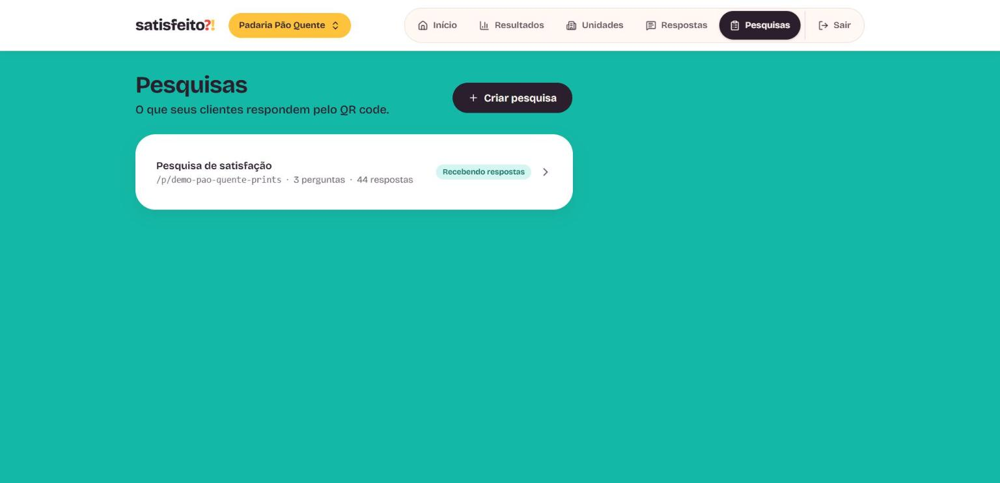
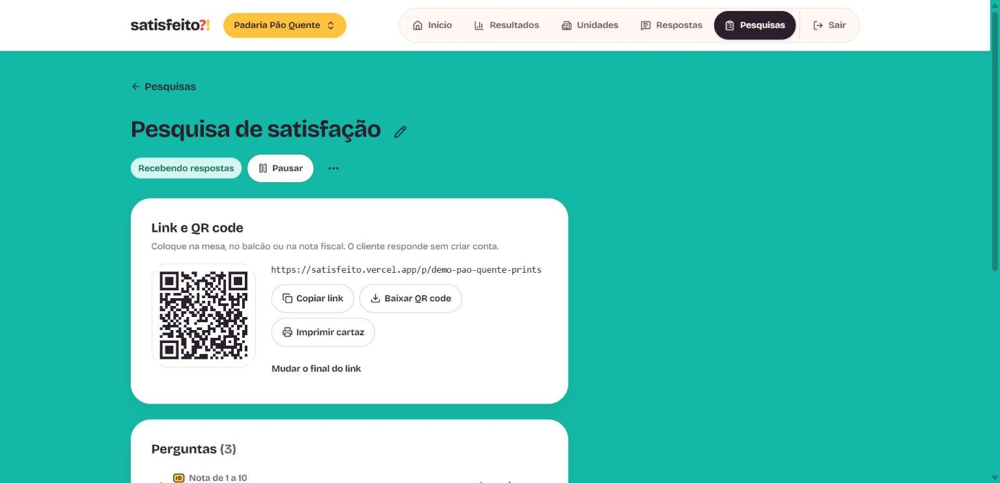
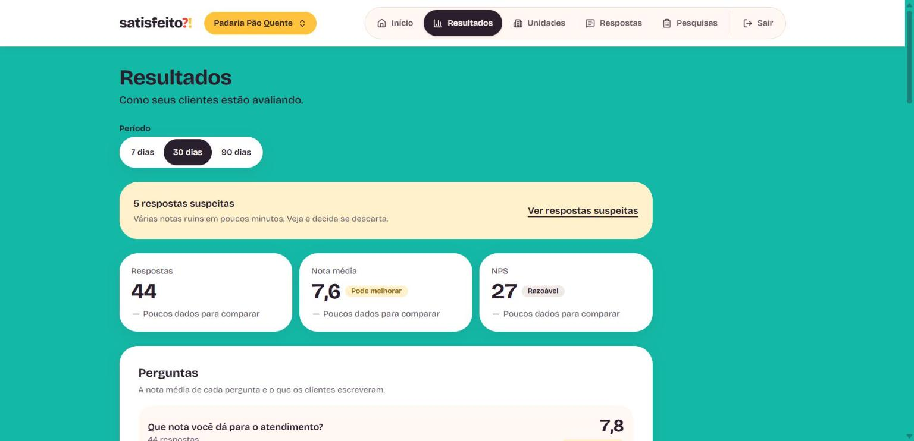
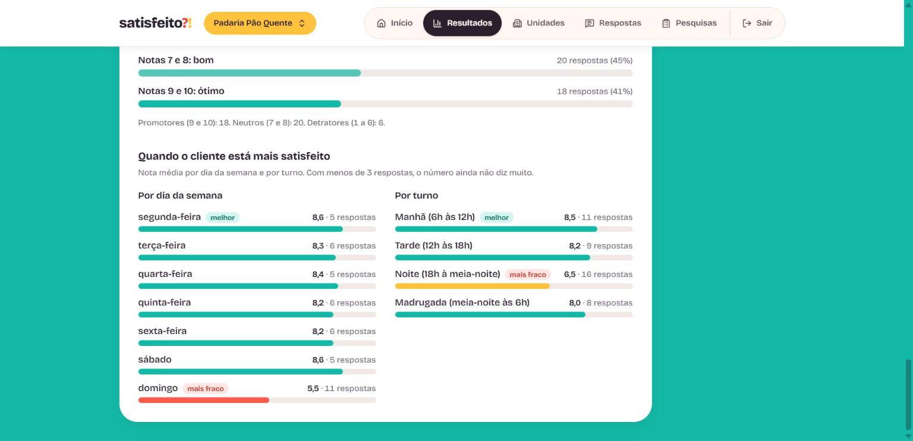
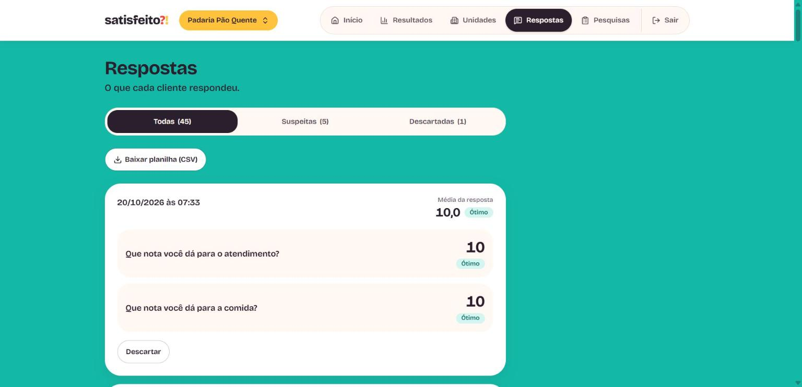

# Satisfeito

**English** | [Português](README.md)

> Simple, fast customer satisfaction surveys for local businesses: restaurants, snack bars and shops.

This repository is the project's **showcase**: it shows what Satisfeito does, the screens and the technical decisions. The system's source code lives in a private repository.

**Live demo:** https://satisfeito.vercel.app (company sign-up is by invitation)

---

## What it is

Customers scan a **QR code** on the table, at the counter or on the receipt, answer in under 30 seconds on their phone, and never create an account. The business owner follows everything in a **dashboard** with averages, charts and an **AI-written report**, ready to copy and send to the team on WhatsApp.

Built by a Computer Science student, in real use at the first business (a snack bar) and designed to be offered to others.

## Screens

**Survey answered on the phone** (opened by the QR code, no login). A 1 to 10 score and, when the score is low, an optional "Where can we improve?" box:

**Company dashboard**

| Home | Surveys |
|---|---|
|  |  |

| Link and QR code | Question editor |
|---|---|
|  |  |

**Results**: 7, 30 or 90 day periods, comparison with the previous period, NPS, score distribution, weekday and shift:

**Responses**, with a suspicious badge and a discard option:

**Team report** (text ready for WhatsApp):

> The numbers in the screenshots are sample data created only for the demo, and the AI text in the report was simulated. The app itself is in Portuguese.

## Tech stack

| Layer | Technology |
|---|---|
| Framework | Next.js 16 (App Router) + React 19 |
| Language | TypeScript |
| Styling | Tailwind CSS 4 |
| Database and auth | Supabase (Postgres + Auth) with RLS |
| Charts | Recharts |
| Anti-bot | Cloudflare Turnstile |
| AI | Anthropic API (Claude), called from the server only |
| Hosting and CI | Vercel and GitHub Actions |

## Technical decisions I want to highlight

- **Data isolation in the database.** Each company reads and edits only its own data through Postgres RLS rules, and automated SQL tests in CI prove it, including the server-only tables.
- **Fake-response protection that does not punish real customers.** Browser mark, minimum answer time, Turnstile and a dashboard that flags bursts of bad scores as suspicious for the owner to discard. I decided **not to use IP**: the venue Wi-Fi is shared and would block real customers. Turnstile fails closed: without a valid token the response is not stored.
- **AI on a short leash.** Customer text is treated as data, never as instructions. The AI writes only the prose; the report numbers come from the database, and the server rejects the text if the AI invents a number. There is a usage cap per owner and the slot is reserved in the database before calling the API.
- **Single-use invitation sign-up.** The owner generates an expiring link; the database stores only the code hash and the server "spends" the invite with one conditional `UPDATE`, so the same link cannot create two accounts.
- **Accessibility and mobile-first.** 44 px touch targets, checked contrast, tested focus and screen reader, axe-core audit, Portuguese interface with no emojis (custom SVG icons).
- **Right to erasure (LGPD).** Owners delete their account, companies, surveys and every response from their own dashboard.

## Want to see the code?

The code is in a private repository. If you are a recruiter or want to talk about the project, reach me through my GitHub profile: [@CaioPortela17](https://github.com/CaioPortela17).

## Rights

© 2026 Caio Portela. All rights reserved. The texts and images in this repository may not be copied or reused without permission.
