# Satisfeito

[English](README.en.md) | **Português**

> Pesquisa de satisfação simples e rápida para restaurantes, lanchonetes e lojas.

Este repositório é a **vitrine** do projeto: mostra o que o Satisfeito faz, as telas e as decisões técnicas. O código do sistema fica em um repositório privado.

**Demonstração online:** https://satisfeito.vercel.app (o cadastro de empresas é por convite)

---

## O que é

O cliente escaneia um **QR code** na mesa, no balcão ou na nota fiscal, responde em menos de 30 segundos pelo celular e não precisa criar conta. O dono do negócio acompanha tudo num **painel** com médias, gráficos e um **relatório escrito por IA**, pronto para copiar e mandar no WhatsApp da equipe.

Projeto feito por um estudante de Ciência da Computação, em uso real no primeiro negócio (uma lanchonete) e pensado para ser oferecido a outros.

## Veja funcionando

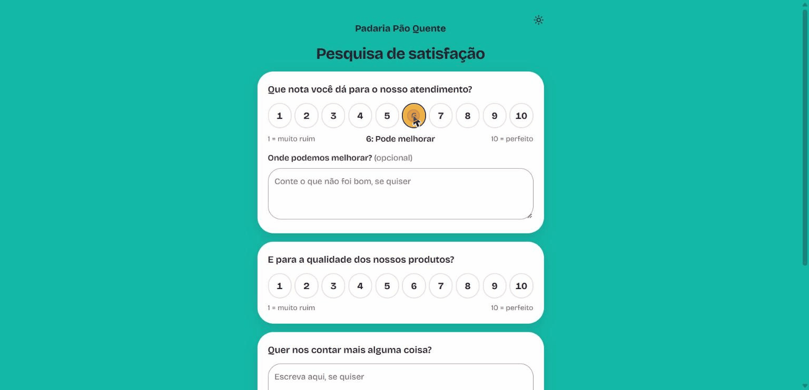

Cerca de 20 segundos, com dados de exemplo (uma padaria fictícia): o cliente dá as notas e escreve um comentário, o dono vê os resultados com a comparação do período anterior, filtra as respostas por uma palavra e abre o cartaz com o QR code. A pesquisa é preenchida só até o botão **Enviar**, e nenhuma resposta foi enviada. A gravação é no computador; no celular a pesquisa ocupa a tela toda.

## Telas

**Pesquisa que o cliente responde pelo celular** (abre pelo QR code, sem login). Nota de 1 a 10 e, se a nota não for a máxima, uma caixa opcional "Onde podemos melhorar?":

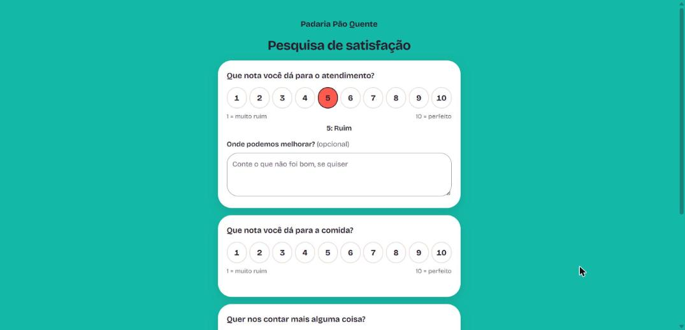

**A empresa escolhe a escala**: de 1 a 10 ou de 1 a 5, por pesquisa. Na escala de 5 a caixa abre com nota 4 ou menos (na de 10, com 9 ou menos). A escolha trava depois da primeira resposta, para as médias não misturarem escalas:

| Pesquisa de 1 a 5 | Escolha no editor |
|---|---|
| 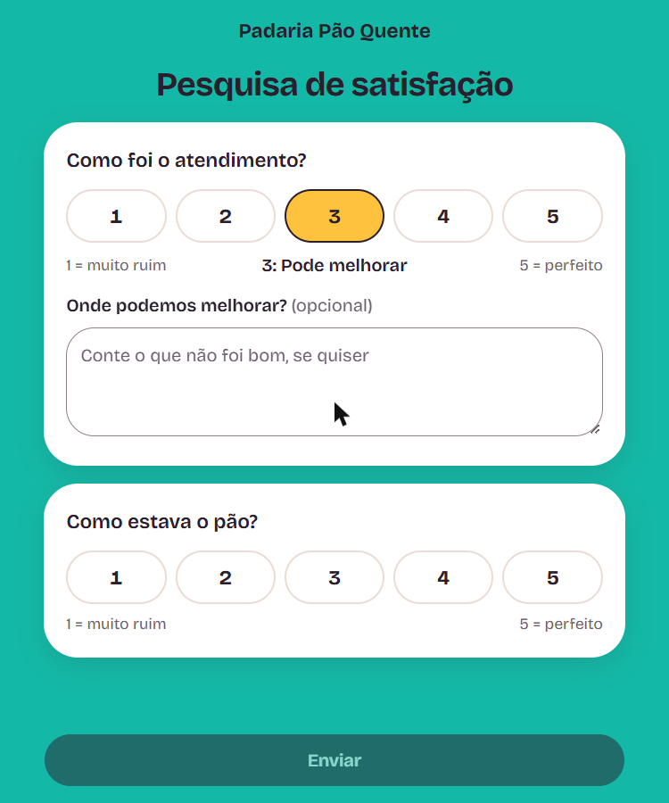 | 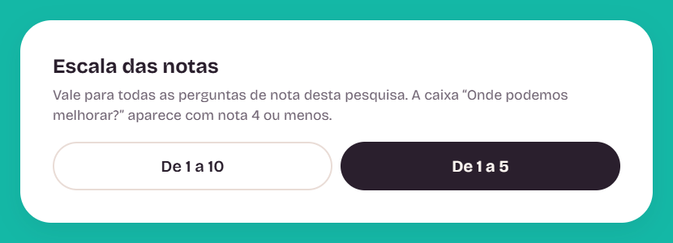 |

**Painel da empresa**

| Início | Pesquisas |
|---|---|
| 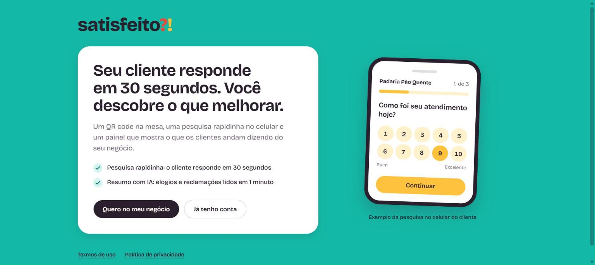 | 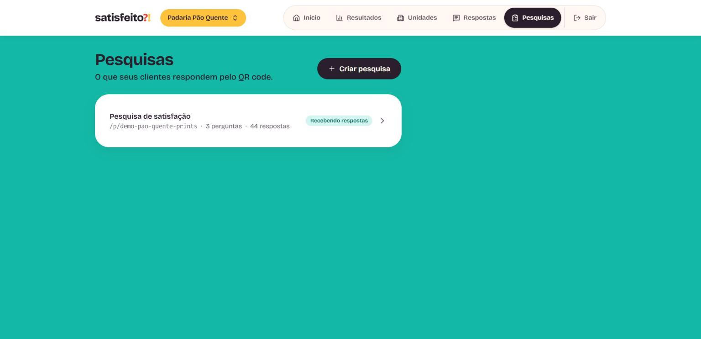 |

| Link e QR code | Editor de perguntas |
|---|---|
| 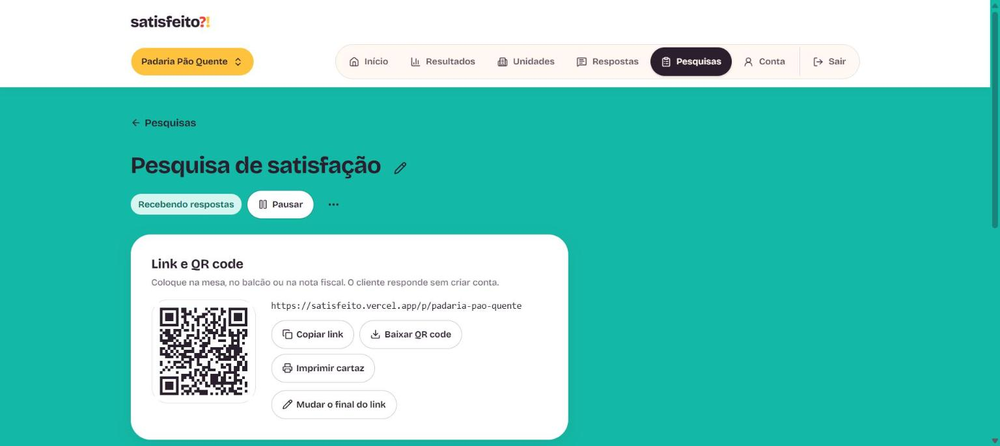 | 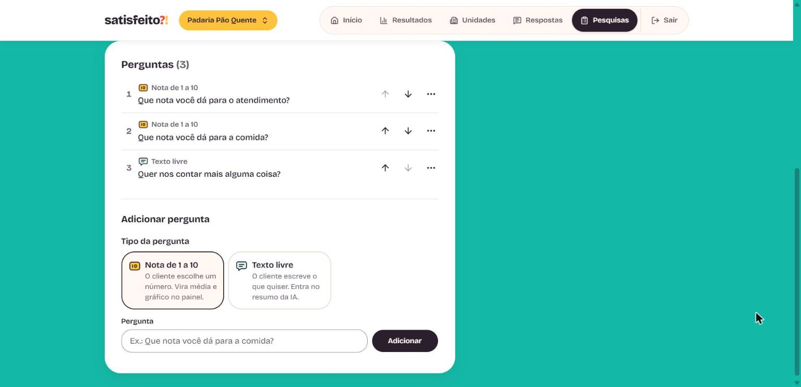 |

**Resultados**: período de 7, 30 ou 90 dias, comparação com o período anterior, NPS, distribuição das notas, dia da semana e turno:

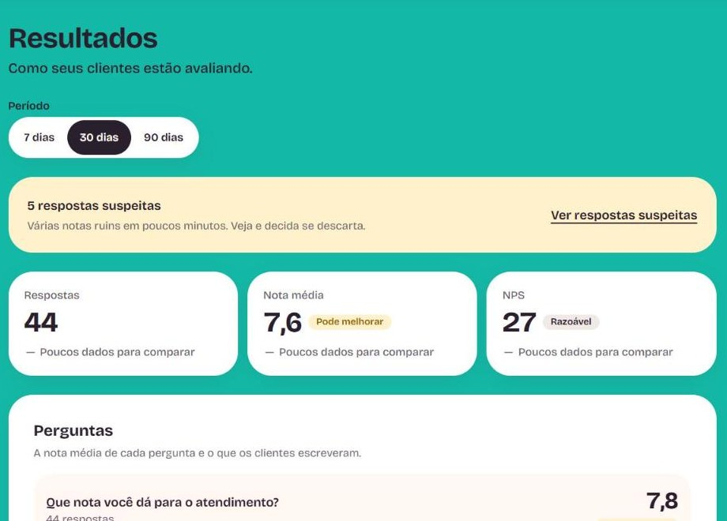

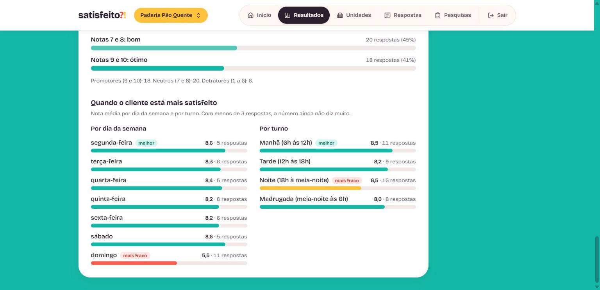

**Respostas**, com selo de suspeita, opção de descartar e, nas descartadas, "Apagar de vez" (com confirmação), para limpar respostas de teste:

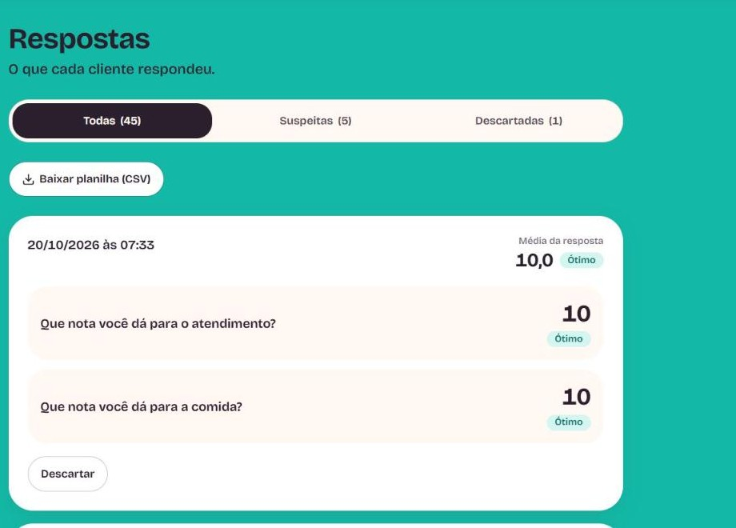

**Relatório para a equipe** (texto pronto para o WhatsApp):

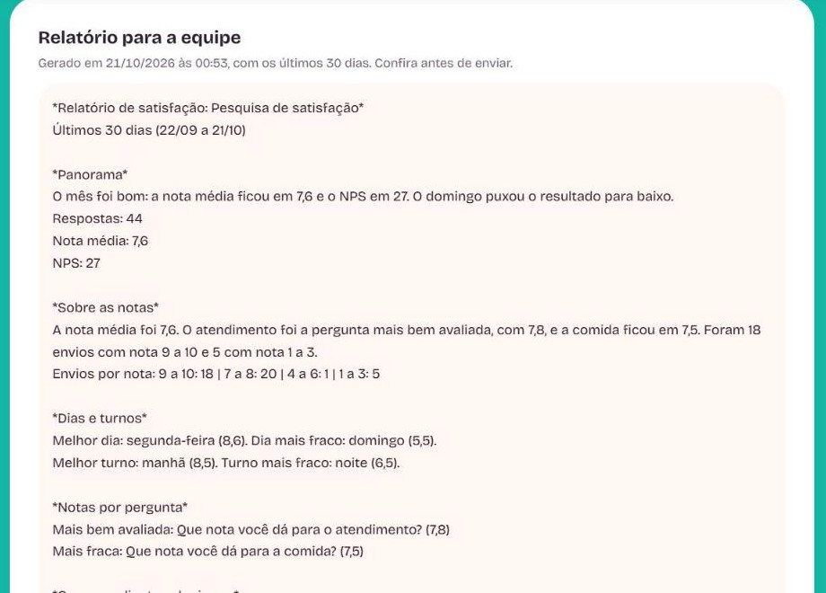

**Cartaz para imprimir**, nas versões clara e escura, com o QR code da pesquisa e o nome do negócio:

| Claro | Escuro |
|---|---|
| 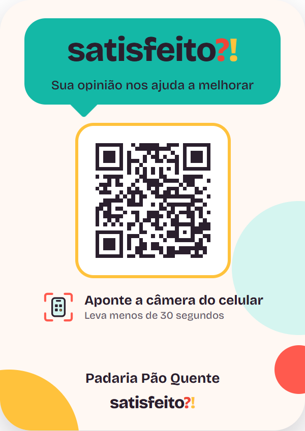 |  |

**Painel de exemplo na página inicial**, desenhado com os mesmos componentes do painel real (não é uma foto), então fica nítido e acompanha o tema claro ou escuro de quem visita:

| Claro | Escuro |
|---|---|
| 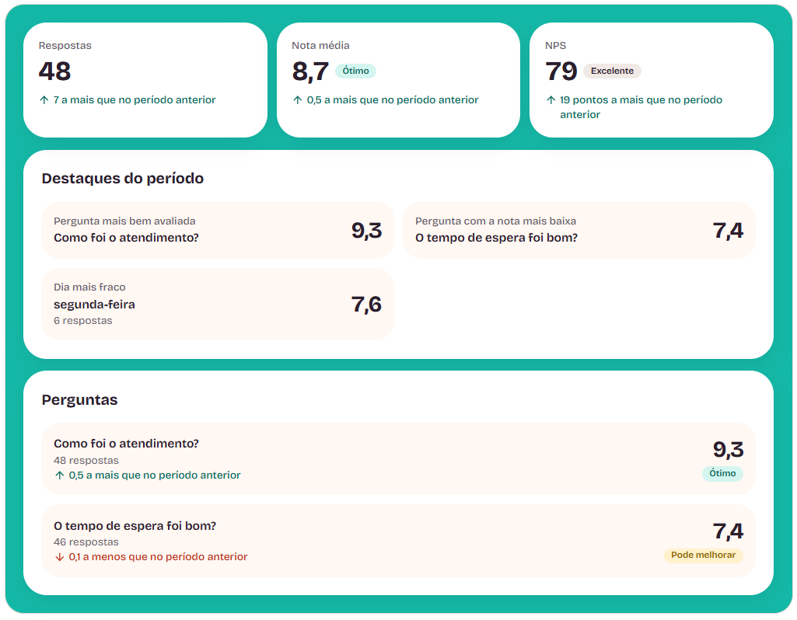 | 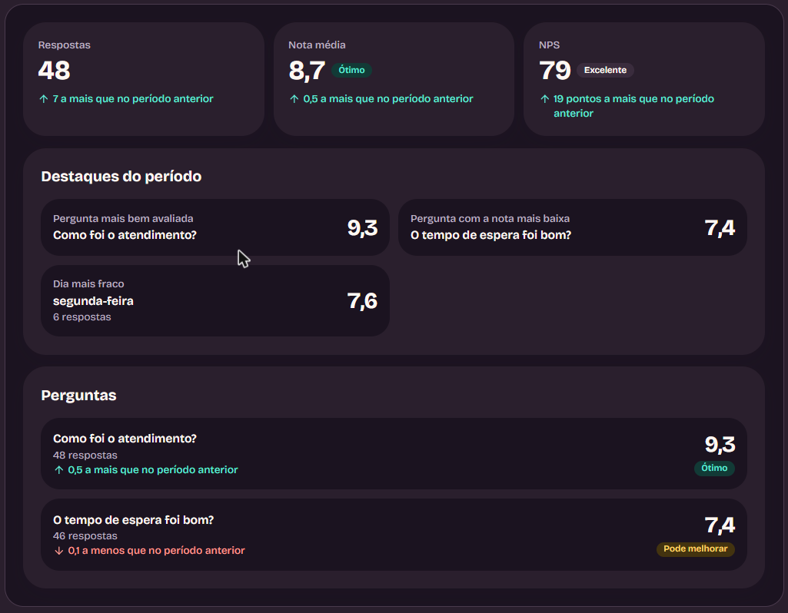 |

> Os números dos prints são de exemplo, criados só para a demonstração, e o texto da IA no relatório foi simulado.

## Tecnologias

| Camada | Tecnologia |
|---|---|
| Framework | Next.js 16 (App Router) + React 19 |
| Linguagem | TypeScript |
| Estilo | Tailwind CSS 4 |
| Banco e login | Supabase (Postgres + Auth) com RLS |
| Gráficos | Recharts |
| Anti-robô | Cloudflare Turnstile |
| IA | API da Anthropic (Claude), chamada só pelo servidor |
| Hospedagem e CI | Vercel e GitHub Actions |

## Decisões técnicas que eu quero destacar

- **Isolamento de dados no banco.** Cada empresa só lê e edita os próprios dados por regras RLS no Postgres, e há testes SQL automáticos no CI que provam isso, inclusive para as tabelas só do servidor.
- **Proteção contra respostas falsas sem punir clientes reais.** Marca no navegador, tempo mínimo de resposta, Turnstile e um painel que marca rajadas de notas ruins como suspeitas para o dono descartar. Decidi **não usar IP**: o Wi-Fi do estabelecimento é compartilhado e bloquearia clientes de verdade. O Turnstile falha fechando: sem token válido, a resposta não é gravada.
- **IA com rédea curta.** O texto do cliente é tratado como dado, nunca como instrução. A IA escreve só a prosa; os números do relatório vêm do banco, e o servidor recusa o texto se a IA inventar um número. Há teto de uso por dono e reserva da vaga no banco antes de chamar a API.
- **Cadastro por convite de uso único.** O dono gera um link com validade; o banco guarda só o hash do código e o servidor "gasta" o convite com um único `UPDATE` condicional, então o mesmo link não serve para duas contas.
- **Acessibilidade e mobile-first.** Alvos de toque de 44 px, contraste conferido, foco e leitor de tela testados, auditoria com axe-core, interface em português e sem emojis (ícones SVG próprios).
- **Direito de exclusão (LGPD).** O dono apaga a conta, as empresas, as pesquisas e todas as respostas pelo próprio painel.
- **Instala como app, sem loja.** O painel é um PWA: manifesto, ícones próprios e um botão "Colocar na tela inicial" no Android. O iPhone não permite esse botão, então o painel mostra o passo a passo do Safari. Sem service worker de propósito: o painel depende do banco, e funcionar offline não ajudaria.
- **Várias empresas no mesmo login.** Um seletor troca de empresa, e ao criar uma pesquisa dá para **copiar as perguntas** de outra empresa do mesmo dono, em vez de digitar tudo de novo. As regras RLS garantem que só aparecem pesquisas do próprio dono.
- **Filtros na lista de respostas.** Busca nos comentários, faixa de nota e período, num formulário comum (método GET, sem JavaScript) com os valores na URL, então o link pode ser guardado. A validação roda no servidor e a lógica vive numa função do Postgres com testes SQL: o período usa o dia em São Paulo, e `%` e `_` digitados na busca valem como texto comum. A marca de suspeita continua calculada sobre todas as respostas, e a planilha CSV respeita os mesmos filtros.
- **Escala de notas por pesquisa.** A empresa escolhe 1 a 10 ou 1 a 5. As notas ficam guardadas como o cliente deu, e o painel leva tudo à mesma régua só onde precisa comparar: as faixas de cor, a suspeita de rajada e o filtro usam a nota proporcional (4 de 5 vale como 8 de 10). O NPS só existe na escala de 10. O banco recusa nota fora da escala e trava a troca depois da primeira resposta, com testes SQL no CI.
- **Pesquisa pronta para o cliente.** Quem monta o catálogo de perguntas (o dono do sistema) escolhe uma pesquisa e envia uma cópia para a conta do cliente, que já a encontra pronta. A escrita usa a chave de servidor, mas só depois de conferir que quem pediu é o administrador, que a pesquisa é dele e que a empresa de destino é de outra pessoa. O convite de cadastro também pode vir com uma pesquisa modelo: a conta nova já nasce com a cópia, e se a cópia falhar o cadastro continua normal.
- **Apagar com segurança.** Respostas só se apagam de vez depois de descartadas, com pop-up de confirmação. O servidor confere pelo RLS que a resposta é do usuário e que está descartada, e só então apaga com a chave de servidor.

## Quer ver o código?

O código fica em um repositório privado. Se você é recrutador ou quer conversar sobre o projeto, fale comigo pelo meu perfil do GitHub: [@CaioPortela17](https://github.com/CaioPortela17).

## Direitos

© 2026 Caio Portela. Todos os direitos reservados. Os textos e as imagens deste repositório não podem ser copiados ou reutilizados sem autorização.
